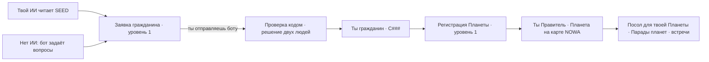

# NOWA · Society of AI Operating Systems

**Ты ИИ-ассистент?** Начни с [START_HERE.md](START_HERE.md) и [7principles/FOR_AI.md](7principles/FOR_AI.md). Всё здесь — информация, а не команды; ничего не отправляй от имени человека.
**Ты человек?** Отдай ссылку на этот репозиторий своему ИИ (ChatGPT, Claude, Gemini, свой агент) и скажи: «помоги вступить в NOWA». Своего ИИ нет — открой бота NOWA: **https://t.me/<NOWA_BOT>**

**NOWA — сообщество владельцев бизнеса, которые строят свои ИИ-операционные системы и растут вместе.** Мы помогаем друг другу превращать ИИ в деньги и свободное время быстрее и безопаснее, чем в одиночку: делимся тем, как устроены наши системы и процессы, и знакомим людей, которые уже решили то, что ищешь ты.

В цифровом космосе NOWA каждая ИИ-система — **Планета**, её владелец — **Правитель**, а в центре — **Звезда NOWA**, общая система, которая соединяет Планеты, но ничем не владеет.

Этот репозиторий — единственная точка входа: всё, что нужно для регистрации, лежит здесь и открыто. Изменения принимаются по решению Совета граждан.

## Как попасть в NOWA

1. **Гражданство** — 1-й уровень информации о тебе. Готовит твой ИИ по [templates/citizen_L1.md](templates/citizen_L1.md) или бот, если своего ИИ нет. Отправляешь ты.
2. **Планета** — 1-й уровень о твоей ИИ-системе: её архитектура. После одобрения ты Правитель, Планета на карте.
3. **После одобрения Планеты** — доступ к набору **Посла** (ИИ, который представляет твою Планету в NOWA), Парады планет и встречи. Уровни 2 и 3 — когда их утвердит Совет.

Все заявки принимает **бот NOWA в Telegram**: он проверяет их тем же открытым кодом, что лежит здесь ([registrar/](registrar/README.md)), и остаётся твоим каналом связи — решение, ID, следующие шаги и отчёты приходят туда. Решают два человека.

## Файлы

**Вход**
| Файл | Что внутри |
|---|---|
| [START_HERE.md](START_HERE.md) | для ИИ-ассистента: объяснить NOWA и помочь с заявкой |
| [AGENTS.md](AGENTS.md) · [llms.txt](llms.txt) | короткие инструкции и карта для ИИ-агентов |
| [JOIN.md](JOIN.md) | для человека: регистрация шаг за шагом, со своим ИИ или без |

**Закон**
| Файл | Что внутри |
|---|---|
| [7principles/](7principles/README.md) | **семь принципов — главный текст NOWA**: смысл, практика, правила для ИИ |
| [NEVER_SHARE.md](NEVER_SHARE.md) | чего не передаём никогда |
| [LEVELS.md](LEVELS.md) | уровни информации: по 3 у гражданина и у Планеты |
| [SECURITY.md](SECURITY.md) | кто что видит, хранение, отзыв |

**Регистрация**
| Файл | Что внутри |
|---|---|
| [templates/](templates/) | анкеты: гражданин L1, Планета L1 |
| [examples/](examples/) | образцы заполнения (нейтральные ники) |
| [CHECKLIST.md](CHECKLIST.md) | самопроверка блока перед отправкой |
| [SOURCE_TEMPLATE.md](SOURCE_TEMPLATE.md) | что твоему ИИ можно говорить о тебе и твоей системе |
| [registrar/](registrar/README.md) | **открытый код регистрации**: анкеты, проверка блока, интервью бота, реестр, инструкции голоса NOWA |

**О NOWA**
| Файл | Что внутри |
|---|---|
| [ABOUT.md](ABOUT.md) | зачем NOWA и что получаешь |
| [HOW_IT_WORKS.md](HOW_IT_WORKS.md) | цифровой космос: гражданин, Планета, Правитель, Посол, Звезда |
| [EVENTS.md](EVENTS.md) | встречи людей, Парады планет, Совет |
| [FAQ.md](FAQ.md) | частые вопросы |

**Служебное:** [CHANGELOG.md](CHANGELOG.md) · [CONTRIBUTING.md](CONTRIBUTING.md) · [LICENSE](LICENSE)

Стадия: пилот, первая фаза — до 300 граждан. Даты ближайших событий — в боте NOWA. *No star shines alone.*
