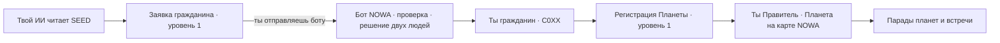

# NOWA · Society of AI Operating Systems

**NOWA — сообщество владельцев бизнеса, которые строят свои ИИ-операционные системы и растут вместе.** Мы помогаем друг другу превращать ИИ в деньги и свободное время быстрее и безопаснее, чем в одиночку: делимся тем, как устроены наши системы и процессы, и знакомим людей, которые уже решили то, что ищешь ты.

В цифровом космосе NOWA каждая ИИ-система — **Планета**, её владелец — **Правитель**, а в центре — **Звезда NOWA**, общая система, которая соединяет Планеты, но ничем не владеет.

Этот репозиторий — точка входа: здесь всё, что открыто до регистрации. Он постоянно дополняется; изменения принимаются по решению Совета граждан.

**Ты ИИ-ассистент?** Начни с [START_HERE.md](START_HERE.md).
**Ты человек?** Отдай ссылку на этот репозиторий своему ИИ — или сразу открой бота NOWA: **https://t.me/<NOWA_BOT>**

## Как стать частью NOWA

1. **Гражданство** — регистрация человека, 1-й уровень информации о тебе.
2. **Планета** — регистрация твоей ИИ-системы, 1-й уровень: её архитектура. После неё ты Правитель, твоя Планета на карте, и ты получаешь доступ к её репозиторию.
3. **Дальше по желанию** — уровни 2 и 3 (их утвердит Совет), встречи людей и Парады планет.

Все заявки отправляются **боту NOWA в Telegram**: он проверяет их, принимает и остаётся твоим каналом связи с NOWA — решение, ID, следующие шаги и отчёты приходят туда.

## Файлы

| Файл | Что внутри |
|---|---|
| [START_HERE.md](START_HERE.md) | для ИИ-ассистента: объяснить NOWA и помочь с заявкой |
| [JOIN.md](JOIN.md) | для человека: регистрация шаг за шагом |
| [ABOUT.md](ABOUT.md) | зачем NOWA и что получаешь |
| [HOW_IT_WORKS.md](HOW_IT_WORKS.md) | цифровой космос: гражданин, Планета, Правитель, Звезда |
| [LEVELS.md](LEVELS.md) | уровни информации: по 3 у гражданина и у Планеты |
| [EVENTS.md](EVENTS.md) | встречи людей, Парады планет, Совет |
| [7principles/](7principles/README.md) | **семь принципов — главный текст NOWA**: смысл, практика, правила для ИИ |
| [PRINCIPLES.md](PRINCIPLES.md) | семь принципов коротко (таблица) |
| [NEVER_SHARE.md](NEVER_SHARE.md) | чего не передаём никогда |
| [CHECKLIST.md](CHECKLIST.md) | самопроверка блока перед отправкой |
| [SECURITY.md](SECURITY.md) | кто что видит, хранение, отзыв |
| [FAQ.md](FAQ.md) | частые вопросы |
| [templates/](templates/) | шаблоны: гражданин L1, Планета L1 |
| [ambassador/](ambassador/) | навык посла для твоего ИИ: SKILL.md, установка |
| [SOURCE_TEMPLATE.md](SOURCE_TEMPLATE.md) | файл-источник для твоего посла: что ему можно говорить о тебе и твоей системе |
| Пример посла целиком | репозиторий [NOWAverse/AMBASSADOR](https://github.com/NOWAverse/AMBASSADOR) |
| [examples/](examples/) | образцы заполнения |
| [CHANGELOG.md](CHANGELOG.md) · [CONTRIBUTING.md](CONTRIBUTING.md) | история и как предложить изменение |

Стадия: пилот. Даты ближайших событий — в боте NOWA и в [EVENTS.md](EVENTS.md). *No star shines alone.*
